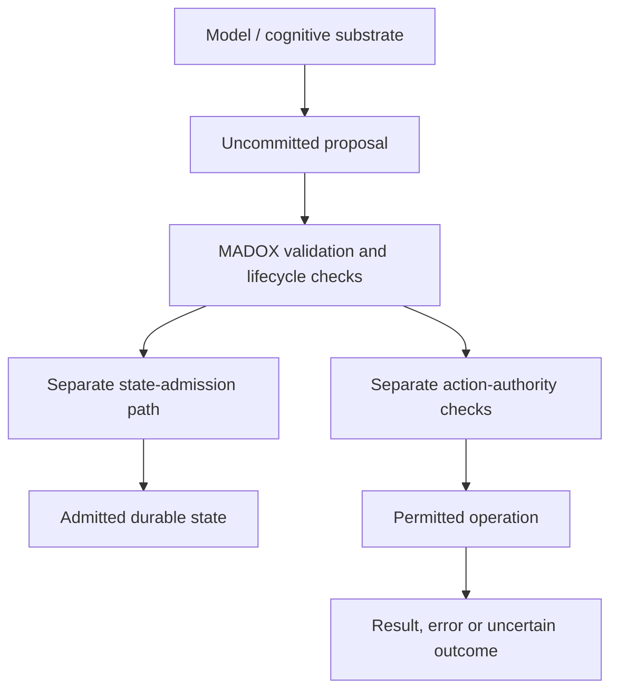

# MADOX

## Persistent Agent Runtime — Public Technical Overview

MADOX is a developing persistent AI-agent runtime designed to separate replaceable cognition from durable state and execution authority.

The central question is: **How should a persistent AI agent separate what a model proposes, what becomes durable canonical state, and what the system is authorized to do?**

MADOX keeps cognition replaceable while runtime-owned services govern state, capability, authority, recovery and external action. The demonstrated scope is bounded software behavior in development tests.

**Reading time:** approximately 10–15 minutes for this README and the five short documents below. Evidence described here was available as of **October 15, 2026**.

## Three boundaries

- **Model / cognition:** proposes responses, candidate state changes or tool requests.
- **MADOX / Body:** the runtime validates proposals and owns admitted durable state. “Canonical” means the system's admitted record; it does not mean verified truth.
- **Authority / capabilities:** runtime checks determine whether a particular operation may execute. The ability to suggest or describe an action does not grant permission to perform it.

This is a conceptual flow, not an automatic pipeline. Proposals may remain uncommitted; validation alone does not authorize an action. See [Architecture](docs/ARCHITECTURE.md).

## Why this matters

A persistent, tool-using system needs to distinguish a model suggestion from an admitted memory or belief, permission from execution, and execution from evidence of completion. After an interruption, an uncertain attempt must not silently become either a success or permission to replay an external effect.

MADOX expresses those distinctions as testable runtime contracts. Comparative benefit over simpler harnesses remains a research question.

## What exists today

These labels describe retained **internal development evidence**. Runnable source and original logs are not public here; results are author-reported, not independently replicated through this repository.

| Status | Selected evidence | Boundary of the claim |
|---|---|---|
| **DEMONSTRATED** | Cognition returns uncommitted candidates; FD053 checks candidate inspection without applying updates. | A tested software contract, not isolation from arbitrary code. |
| **DEMONSTRATED** | FD076's corrected parent/child authority boundary passes an injected Stop/Resume regression. | One specific cooperating service boundary. |
| **SUPPORTED BUT LIMITED** | Restart/checkpoint and finite workflow tests retain selected state and task history. | Bounded recovery scenarios, not general autonomous operation. |
| **SUPPORTED BUT LIMITED** | FD053 composes two provider profiles, actual adapters and persistent state with scripted transport. | No demonstrated broad live cross-model operation. |
| **UNDER CONSTRUCTION** | General persistent autonomy, memory quality evaluation and hardware-backed governing authority. | No completed general or production acceptance claim. |

## Technical case study

[FD076: parent/child authority across interruption](docs/FD076_CASE_STUDY.md) follows a review-identified defect through correction and passing fault injection.

## Limitations

[Current capabilities and limits](docs/CURRENT_CAPABILITIES_AND_LIMITS.md): software authority is not hostile-code containment; persistence is not truth; architectural model agnosticism exceeds the live demonstration available here.

## Human / AI collaboration

[Contribution and AI collaboration](docs/CONTRIBUTION_AND_AI_COLLABORATION.md) describes James Allen's direction and substantial AI design, implementation, testing and review.

[Research questions](docs/RESEARCH_QUESTIONS.md) identifies bounded comparisons to investigate.

## Repository scope

**This repository contains selected public technical documentation derived from a privately developed research/engineering project. The complete MADOX source repository is not public.**

This is a documentation artifact. Source code, security-sensitive implementation details, private conversations, credentials, deployment material and unrelated research projects are intentionally excluded. Publication does not constitute an open-source release; see [Copyright](COPYRIGHT.md).

This public technical overview was prepared in October 2026 as a compact external-review artifact for MADOX.
